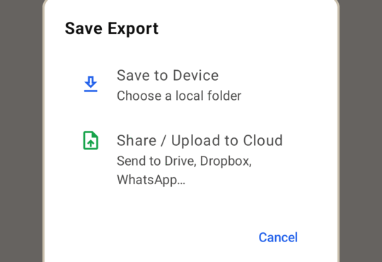

# Backup and restore

Timety keeps all your data on your phone. It has no account and no cloud sync, so a backup file is how you keep your data safe and move it to a new phone.

## What a backup contains

A backup is a single JSON file with all your tasks, recurring tasks, habits, habit stacks, Quick Habits, goals, focus sessions and modes, tags, your profile and mood ratings, and your settings. A few things that only make sense on one phone, like whether Timety already asked you for a permission, stay out of it.

The file isn't encrypted. Keep it somewhere private, since anyone with the file can read your data.

## Export a backup

1. Go to **Settings › Data &amp; Backup**.
2. Tap **Export JSON Data**.
3. Choose where it goes:
   - **Save to Device** lets you pick a folder on your phone.
   - **Share / Upload to Cloud** sends it to another app, like Google Drive, Dropbox or a messenger.

  

The file is called something like `Timety_Export_1763823600000.json`. The number is the time it was made, so newer backups sort after older ones.

> [!TIP]
> Timety doesn't make backups by itself. Export one now and then, for example once a month, and before you reset or replace your phone.

## Restore a backup

> [!WARNING]
> Restoring replaces **all** data and settings in Timety with the ones in the file. Anything you added since the backup is lost. This can't be undone.

1. If a focus session is running, stop it first.
2. Go to **Settings › Data &amp; Backup** and tap **Import JSON Data**.
3. Pick the backup file and confirm.
4. When you see **Restore Successful!**, close Timety completely and open it again.

If the file is damaged or isn't a Timety backup, Timety says so and nothing is changed. Backups from older versions of Timety can be restored in newer ones, but not the other way round: a backup from a newer version needs that version or later.

## Move to a new phone

1. On the old phone, export a backup and save it somewhere you can reach from the new phone, like cloud storage or your computer.
2. On the new phone, install Timety.
3. Restore the backup as described above.

Reminders, alarms and widgets are set up again on the new phone after the restore. You may need to allow notifications and **Background activity** again.

If you move with Android's own phone-to-phone transfer, Timety's data can come along with it. Google's cloud backup doesn't include Timety, so that your data never leaves your devices unless you export it. To be safe, export a backup before you switch anyway.

Can I open the backup file myself?

Yes. It's plain JSON, which any text editor can open and many data tools can import. It's a good way to analyse your data beyond what [Statistics](stats.md) shows. Don't edit a file you plan to restore, though: a mistake can make it unreadable.

