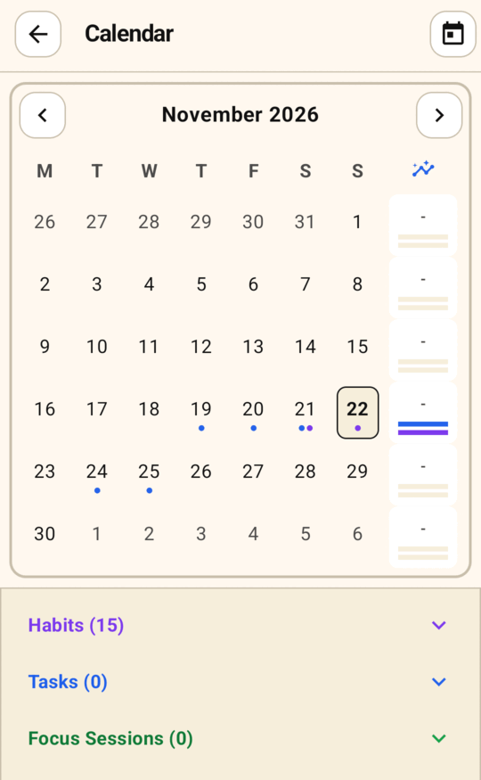

# Calendar

The calendar shows your month at a glance: which days have tasks due, habits done and focus time. Tap a day to see what's on it, or open a weekly or monthly report.

  

## Open the calendar

On Home, tap the calendar button at the top right. Use the arrows next to the month to move between months, and the button at the top right to jump back to today.

## The dots

Small dots under a day show what's on it, one dot per kind:

- **Blue**: tasks due that day.
- **Purple**: habits done that day.
- **Green**: focus sessions.

A habit you do several times a day only gets its dot once you've reached the number for that day.

## A day's lists

Tap a day to see its **Habits**, **Tasks** and **Focus Sessions** below the month. Tap a section to expand it.

- Check off tasks and recurring tasks right from the list, or tap one to open it.
- Check off habits for that day. This is the quickest way to fill in a habit you forgot yesterday. Future days can't be checked off, since a habit is done on the day itself.
- Focus sessions show their mode, time and target.

## Weekly summaries

The column on the right has one box per week. It shows:

- the week's **focus time** at the top, or "-" if there was none.
- a **blue bar** for tasks completed and a **purple bar** for habit check-ins. The bars compare the weeks you can see: the busiest week has the longest bars.

Tap a week's box to open its **Weekly Report**.

## Reports

The **Weekly Report** and the **Monthly Report** (the button above the week column) sum up a period:

- **Tasks due** and **Tasks completed**
- **Habit check-ins**
- **Focus sessions** and **Focus time**

Each number shows how it changed compared with the period before. For a week or month that's still going, Timety compares the same number of days: on 22 October, it compares 1 to 22 October with 1 to 22 September. The report says which days it compared with.

Why does a recurring task only show one dot?

The calendar shows a recurring task on its next due date, and on the days you completed it. It doesn't draw every future round, since those would fill the whole month.

