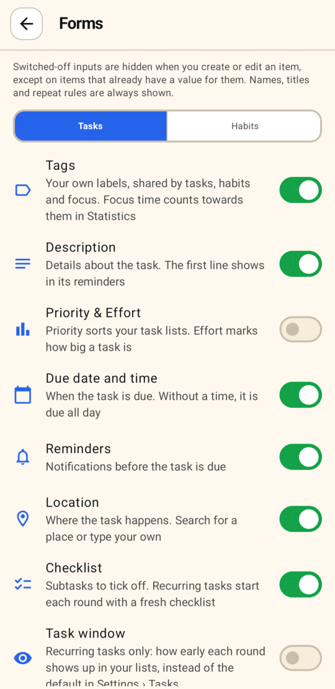

# Customize forms

Choose which inputs the task and habit editors show. Switch off what you never use to keep the editors short, or switch on the inputs a new install hides.

  

## Open the forms settings

Go to **Settings › Forms**. The page has two tabs, **Tasks** and **Habits**, with a switch for each input and a short note on what it does. The task inputs apply to [recurring tasks](tasks/recurring-tasks.md) too.

A switched-off input is hidden whenever you create or edit an item. Names, titles and repeat rules are always shown, because every item needs them.

> [!NOTE]
> An item that already has a value for a switched-off input keeps showing it. If you hide **Location** but a task already has a place, that task still shows its location, so nothing gets lost.

## Inputs hidden on a new install

To keep the editors simple at first, a new install hides a few inputs. Switch them on when you need them:

| Input | Tab | What it does |
| --- | --- | --- |
| **Priority &amp; Effort** | Tasks | How important a task is, and how big. See [Tasks](tasks/index.md#priority-and-effort). |
| **Location** | Tasks | Where a task happens, with place search. See [Tasks](tasks/index.md#location). |
| **Task window** | Tasks | How early each round of a recurring task shows up. See [Recurring tasks](tasks/recurring-tasks.md#the-task-window). |
| **Habit Stack** | Habits | Group habits into a routine. See [Habit stacks](habits/habit-stacks.md). |
| **Times per day** | Habits | Check in more than once a day. See [Habits](habits/index.md#several-times-a-day). |

If you used one of these before the Forms settings existed, it was switched on for you when you updated.

## Task inputs

- **Tags**: your own labels, shared with habits and focus.
- **Description**: details about the task. Its first line shows in the task's reminders.
- **Priority &amp; Effort**
- **Due date and time**: without a time, the task is due all day.
- **Reminders**: notifications before the task is due. They need **Due date and time** switched on.
- **Location**
- **Checklist**: subtasks to tick off. Recurring tasks start each round with a fresh checklist.
- **Task window**: recurring tasks only.

## Habit inputs

- **Tags**
- **Notes**: why you're building the habit, or anything else to remember.
- **Habit Stack**
- **Icon**: a symbol shown next to the habit.
- **Color**: switched off, new habits are purple.
- **Times per day**: not for flexible habits.
- **Reminders**: notifications at set times.

I switched an input off. Is its data deleted?

No. Switching an input off only hides it in the editor. Items that already have a value keep it and still show it, and switching the input back on brings it back everywhere.

