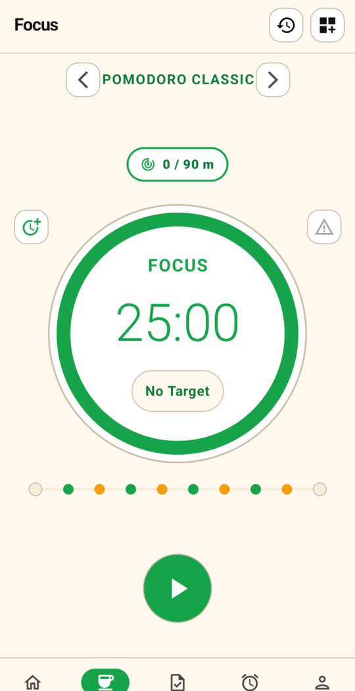

# Focus

The Focus tab is a timer for focused work. Pick a mode, link the session to what you're working on if you like, and Timety records the time so you can see it in your statistics.

  

## Start a session

1. Open the **Focus** tab.
2. Use the arrows at the top to pick a mode.
3. Optional: tap **No Target** to pick what you're working on. See [Targets](#targets).
4. Tap **Start**.

While the timer runs, you can **Pause** and **Resume** it, or **Stop** it to save the session. **Reset** throws the session away. Both ask first, and the timer pauses while you decide.

The timer keeps going when you leave the app or lock the phone. Its notification shows the time left and has **Pause** and **Stop** buttons.

> [!NOTE]
> Sessions shorter than one minute aren't saved, so an accidental tap on **Start** doesn't end up in your statistics.

## Modes

Timety comes with three modes:

- **Pomodoro Classic**: four rounds of focus with short rests in between, starting with 25 minutes of focus.
- **Flexible**: a single focus block of any length. Before you start, drag the dial to set the time.
- **Stopwatch**: counts up until you stop it. To catch a stopwatch you forgot about, it stops at the **Max Stopwatch Limit** in **Settings › Focus**.

When a phase ends, Timety plays a sound and waits for you. Tap **Continue** to start the next phase, for example your break.

### Create your own mode

1. Tap the **Manage Modes** button at the top of the Focus tab.
2. Tap **New Mode** and enter a **Mode Name**.
3. Under **Timeline Phases**, add focus and rest phases and set their **Duration (minutes)**. Tap a phase to change or delete it.
4. Save the mode.

The three built-in modes can't be changed. A mode you've already logged sessions with can't be deleted, so its sessions keep their mode.

## Targets

A target links a session to what you're working on. Tap **No Target** to open **Select Focus Target**, which has four tabs:

- **Tags**: count the time towards an area, like "Work" or "University".
- **Tasks**: a task or, at the top, a recurring task.
- **Habits**: a habit you do with a timer, like meditating.
- **Goals**: an active goal.

The target stays the same for the whole session. A session with a task, habit or goal as its target also gets that item's [tags](tags.md), so its time counts towards them in [Statistics](stats.md).

A habit that's locked in a [stack](habits/habit-stacks.md) can't be picked until the habit before it is done.

### Complete the target when the timer ends

Switch on **Auto-complete linked task or habit** in **Settings › Focus** to check off the target when a focus timer finishes. It happens once per session, not after every phase. A recurring task completes its current round.

Goals are never completed this way, and focus time doesn't add to a goal's progress. Log goal progress yourself, see [Goals](goals.md).

## Distractions

Got distracted? Tap the **Distractions** button on the right of the timer and pick what happened: **Distracted**, **Hydrated / Drink**, **Restroom**, **Snack** or **Stretched**. Statistics show when you usually get distracted.

## Log a past session

Forgot to start the timer? Tap **Log Past Session** on the left of the timer. Pick the **Focus Mode**, the **Start Time**, the **Duration** and optionally a target, and save.

You can also log focus time when you check off a task, see [Complete a task](tasks/index.md#complete-a-task).

## Focus history

Tap the **Focus history** button at the top of the Focus tab to see all your sessions, grouped by day.

- **Search** the sessions by what they show, like the target's name, and filter by **Date**, **Tags**, **Target** or **Mode**.
- **Sort** by newest, oldest or longest first.
- Tap a session to **Edit Session**: change its times, mode or target, or delete it.

## Daily focus target

Set how many minutes you want to focus per day under **Daily Focus Goal** in **Settings › Focus**. You can also choose on which weekdays it applies, for example only on workdays.

Your progress shows on Home as **Focus Today** and above the timer. Set the target to 0 to switch it off; Home then hides the bar.

## Settings

**Settings › Focus** also has:

- **Auto Do Not Disturb**: silences notifications during focus sessions. With **Lift During Breaks**, they come back while you rest. Timety asks for permission the first time.
- **Keep Screen On**: keeps the screen from sleeping while a session runs.
- **Max Phase Node Time**: the longest a single phase of your own modes can be.
- **Ask to log focus time**: the prompt when you check off a task.

The timer stopped when I closed the app. What happened?

Some phones stop apps in the background to save battery. Open **Settings › Notifications** and allow **Background activity**, and make sure Timety's notifications are allowed, since the running timer needs its notification.

