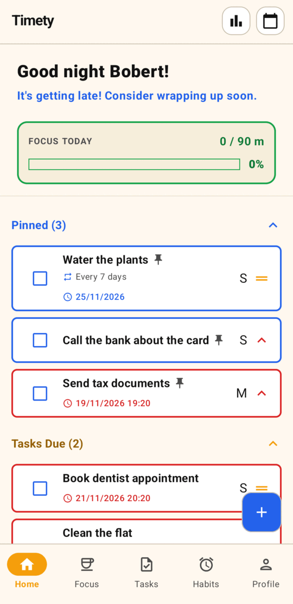
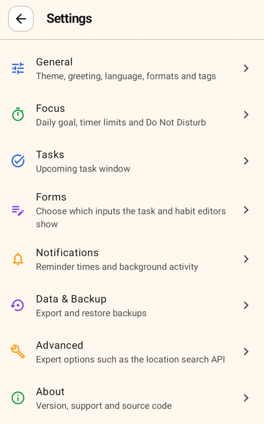

# Getting started

A quick tour of Timety: the five tabs, how to add your first task and habit, how to start a focus session, and where the settings are.

  

## The five tabs

The bar at the bottom of the screen has five tabs. Each one has its own color, and the guides use the same colors.

| Tab | What it's for |
| --- | --- |
| **Home** | What needs your attention today: pinned items, today's habits, tasks that are due and tasks coming up soon. |
| **Focus** | A timer or stopwatch for focused work, linked to a task, habit, goal or tag if you like. |
| **Tasks** | Everything you need to get done, with due dates, reminders and checklists. Recurring tasks have their own page here. |
| **Habits** | Things you want to do regularly. Goals and Quick Habits also live here. |
| **Profile** | Your name and avatar, your mood calendar, and the way into **Settings**. |

## Home

Home shows a greeting and a **Focus Today** bar for your daily focus target. A new install starts with 90 minutes; change it or set it to 0 to hide the bar in **Settings › Focus**, see [Daily focus target](focus.md#daily-focus-target). Below that are up to four sections:

- **Pinned**: tasks and habits you pinned, whatever their due date. See [pinning a task](tasks/index.md#pin-a-task).
- **Habits Today**: habits due today that aren't done yet. Habits in a [stack](habits/habit-stacks.md) stay here with their stack until the whole stack is done.
- **Tasks Due**: tasks due today or overdue.
- **Upcoming Tasks**: tasks due in the next few days. How far ahead this looks is the **Upcoming Task Window** in **Settings › Tasks**, 7 days by default.

Tap a section's title to collapse or expand it. Timety remembers your choice, so a section that looks empty may just be collapsed.

Tap the checkbox to check off a task or habit right from Home. Tap anywhere else on it to open it.

The two buttons at the top open [Statistics](stats.md) and the [Calendar](calendar.md).

## Add your first task

1. On Home or the **Tasks** tab, tap the **+** button.
2. Enter a **Task Title**. It's the only field you have to fill in.
3. To give it a deadline, tap **Set Due Date** and pick a day. Add a **Due time** if it's due at a set time.
4. Tap the check mark at the top to save.

Everything else, like reminders, a checklist and tags, is explained in [Tasks](tasks/index.md).

## Add your first habit

1. On the **Habits** tab, tap the **+** button.
2. Enter a **Habit Name**, for example "Read 10 pages".
3. Pick a **Frequency**: **Daily**, **Flexible**, like "3 days a week", or **Specific** days of the week.
4. Save it.

The habit now shows up on Home on the days it's due. Tap its circle when you've done it. More in [Habits](habits/index.md).

## Start a focus session

1. Open the **Focus** tab.
2. Use the arrows at the top to pick a mode: **Pomodoro Classic**, **Flexible** or **Stopwatch**.
3. Optional: tap **No Target** to link the session to a task, habit, goal or tag.
4. Tap **Start**.

The timer keeps running when you leave the app, with a notification you can use to pause or stop it. See [Focus](focus.md) for modes, breaks and logging past sessions.

## Reminders on first launch

On first launch, Timety asks to send notifications. Allow it, or you won't get any reminders.

Right after, it may ask you to **Enable reliable reminders**. This opens Android's **Alarms &amp; reminders** setting for Timety. Without it, Android can delay task and Quick Habit reminders by several minutes while your phone is idle. **Not now** asks again the next time you open Timety; **Don't ask again** stops asking. You can still turn it on later under **Settings › Notifications**.

## Settings

To open Settings, go to the **Profile** tab and tap the gear at the top right.

  

A few settings worth a look early on:

- **General**: theme, language, date and time format, and your [tags](tags.md).
- **Forms**: which inputs the task and habit editors show. Some are hidden on a new install. See [Customize forms](customize-forms.md).
- **Notifications**: the times of the morning motivation and the evening checkup. If reminders arrive late, **Background activity** lets Timety run in the background.
- **Data &amp; Backup**: export your data now and then. Timety keeps everything on your phone, so a backup is the only copy. See [Backup and restore](backup-and-restore.md).

> [!TIP]
> Timety works fully offline and has no account. The only feature that needs internet is the place search in a task's **Location**.

## Your profile

The **Profile** tab shows your name and avatar, which Home uses in its greeting. Tap the name or avatar to change them.

Below them is a mood calendar. Tap a day to rate it with a face, or answer "How was your day?" when it appears in the evening. The bar under the calendar shows how your rated days add up over time.

The share button next to the gear opens **Share Wrap-up**: a picture summing up your time with Timety, which you can send to friends or post.
