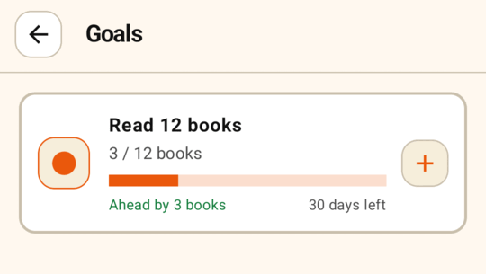

# Goals

A goal is a bigger target with a deadline, like "Read 12 books by December" or "Ride 500 km this summer". Log your progress as you go, and Timety tells you whether you're on pace.

  

## Open your goals

Goals live on the **Habits** tab: tap the flag button at the top to open **Goals**. Active goals are at the top, finished ones under **Completed**.

## Create a goal

1. On **Goals**, tap the **Add New Goal** button.
2. Enter a **Goal Name**.
3. Under **Target**, enter the number you want to reach and its **Unit**, for example 12 and "books", or 500 and "km".
4. Pick a **Deadline**. The whole day counts, so a goal finished on its deadline is on time.
5. Optional: add **Tags**, a **Description**, an **Icon** and a **Color**.
6. Tap the check mark to save.

## Log progress

Tap the **Log progress** button on a goal, enter the **Amount** and when you made it (**Logged at**), and confirm. Progress is the sum of everything you've logged.

To correct a mistake, open the goal and remove the entry from its **Progress Log**. Entries can't be edited; remove the wrong one and log it again.

> [!NOTE]
> Focus sessions with a goal as their target record your time, but don't add to the goal's progress, since a goal can be counted in books or kilometres rather than hours. Log the progress yourself.

## Pace

Each goal shows how you're doing compared with a steady pace from the day you created it to the deadline:

- **On track**: right where a steady pace would put you.
- **Ahead by** or **Behind by**: how many units you're ahead of or behind that pace.

Below that you see how many days are left, **Due today**, or how many days it's overdue.

## When a goal is done

A goal completes by itself as soon as its progress reaches the target, and moves to **Completed** with the date you finished it.

If you remove entries and the progress drops below the target again, or you raise the target, the goal becomes active again.

A goal that passes its deadline unfinished stays in the active list, marked as overdue, so you can still finish it. Delete it if you've given it up. Deleting a goal also deletes its progress log.

## In statistics

**[Statistics](stats.md) › Goals** shows all your goals at once: how many are on pace or behind, when each one will be done at your current pace, and how early or late you finished the completed ones.
