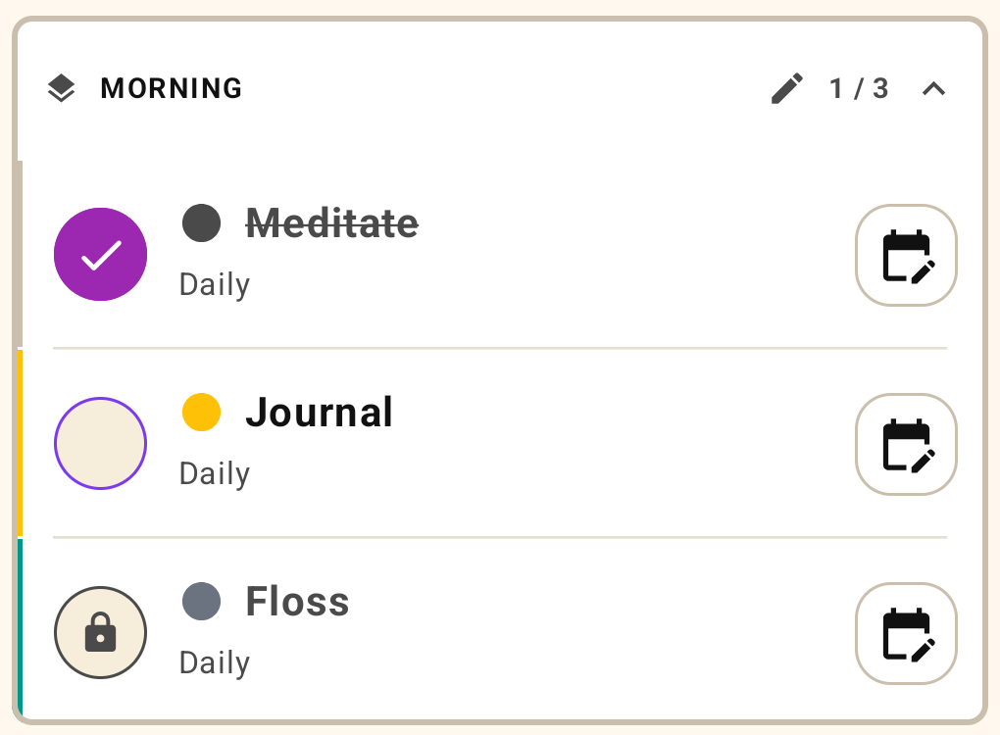
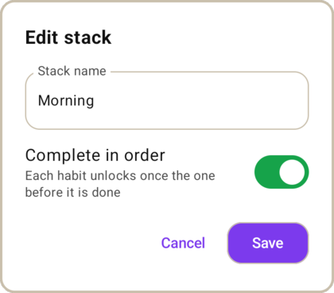

# Habit stacks

A habit stack groups habits you do one after another, like a morning routine, so they show up together and can be checked off in a fixed order.

  

## When to use a stack

Stacks are for routines where one habit leads into the next: drink a glass of water, stretch, then journal. Each habit in a stack keeps its own frequency, streak and reminders. The stack only groups the habits, puts them in order, and can make them unlock one after another.

## Turn on the stack input

On a new install, the Habit Stack input is hidden in the habit editor. To show it, go to **Settings › Forms**, open the **Habits** tab and switch on **Habit Stack**. If you used stacks before this setting existed, it's already on.

> [!NOTE]
> A habit that is already in a stack always shows its stack, even with the switch off.

## Create a stack

1. Create a habit, or open one and tap the edit button.
2. Next to **Habit Stack**, tap the **+** button.
3. Enter a **Stack name**, for example "Morning", and confirm.
4. Save the habit.

To add more habits, pick the stack from the **Habit Stack** dropdown in their editor. A habit that joins a stack goes to the end of it. To take a habit out, pick **No stack**. A stack disappears once its last habit has left.

## Change the order

1. On the **Habits** tab, tap the **Reorder habits** button next to the search bar.
2. Expand the stack and drag its habits into the order you do them.
3. Tap the button again to finish.

In reorder mode you can also drag whole stacks to change their order. Stacks always stay above habits that aren't in a stack.

## Complete in order

New stacks have **Complete in order** switched on. In such a stack:

- **A habit unlocks once the one before it is done.** Until then it shows a lock instead of its checkbox, and tapping it shows "Complete the previous habit in the stack first!"
- **Undo goes backwards.** To uncheck a habit, first uncheck the ones after it. Otherwise you'll see "Uncheck the later habits in this stack first".
- **Only today's habits count.** A habit that isn't due today is skipped and doesn't block the rest.

The same order applies to the Focus tab, where a locked habit can't be picked as a focus target, and to the habits widget.

If you'd rather check off a stack's habits in any order, switch **Complete in order** off for that stack.

## Edit a stack

On the **Habits** tab, tap the pencil on the stack's header. It opens **Edit stack**, where you can:

- change the **Stack name**. Two stacks can't share a name, so renaming to a name that's already used is blocked.
- switch **Complete in order** on or off.

  

The pencil only appears on the Habits tab, and is hidden while reorder mode is on.

## Where stacks show up

On Home and on the Habits tab, a stack is a card with its name and how many of its habits are done today, for example **1 / 3**. Tap the header to expand or collapse it.

On the Habits tab, habits you've done stay with their stack under Due Today until the whole stack is done, so the routine stays together.

Habits in a stack can't be pinned. Pin the habits you want at the top of Home that aren't part of a routine instead.

Why can't I check off a habit?

It's in a stack with **Complete in order** switched on, and the habit before it isn't done yet. Check that one first, or switch **Complete in order** off in the stack's **Edit stack** pop-up.

Why can't I uncheck a habit?

A habit after it in the same stack is done. Uncheck the later habits first, starting with the last one.

