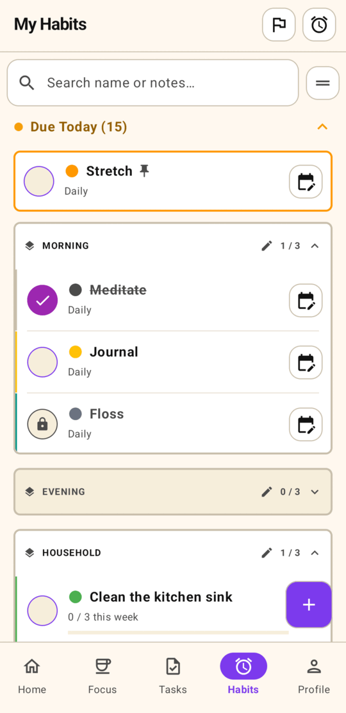

# Habits

Habits are things you want to do regularly, like reading, stretching or brushing your teeth twice a day. Check them in when you've done them, and Timety keeps track of your streaks.

  

## The Habits tab

The **Habits** tab lists your habits in three sections:

- **Due Today**: habits you still have to do today.
- **Upcoming**: habits that aren't due today, like a Monday habit on a Tuesday.
- **Done**: habits you've done today, and flexible habits that reached their target for this week or month.

Search by name or notes with the search bar. The buttons at the top open [Goals](../goals.md) and [Quick Habits](#quick-habits).

Habits in a [stack](habit-stacks.md) are grouped in a card with the stack's name.

## Create a habit

1. On the **Habits** tab, tap the **+** button.
2. Enter a **Habit Name**, for example "Read 10 pages".
3. Choose a **Frequency**, see below.
4. Optional: add **Notes**, **Tags**, **Reminder time**, an **Icon** and a **Color**.
5. Tap the check mark to save.

## Frequency

- **Daily**: every day.
- **Specific**: on the days of the week you pick, like Monday, Wednesday and Friday.
- **Flexible**: a number of days **Per week** or **Per month**, on any days you like, for example "Goal: 3 days a week" for going to the gym.

A weekly flexible habit is due every day until you've reached the week's target, then it moves to **Done** until the next week starts. Monthly flexible habits work the same way per month, but only on the Habits tab: they don't show on Home, in the widget or in reminders, because they're not tied to any particular day.

## Check in

Tap the circle next to a habit, on Home, the Habits tab or the [widget](../widgets.md). Tap it again to undo.

### Several times a day

Some habits happen more than once a day, like brushing your teeth. Switch on **Times per day** in **Settings › Forms** (it's hidden on new installs), then set it in the habit's editor, up to 10. It works for **Daily** and **Specific** habits.

- Each tap on the circle adds one check-in. A bar under the habit shows how many are done, and a message with **Undo** confirms it.
- The day only counts as done once you've reached the number. That's what streaks and statistics use.
- Tapping a finished habit removes one check-in.

To see or remove a single check-in, open the habit. Its **Today** card lists today's check-ins with their time.

### Fill in a past day

Forgot to check in yesterday? Tap the history button on the habit (**Mark past completion**). **Habit History** shows a calendar of the days you've done it. Tap a past day to add it, and enter the time you did it. To remove an entry, tap the delete button next to it in the list.

You can also check off habits for past days in the [calendar](../calendar.md). Future days can't be checked off.

## Reminders

Under **Reminder time**, tap **Add time** to get a notification at that time. Add several times for habits you do more than once a day.

Reminders are skipped on days the habit is already done or isn't due. Monthly flexible habits can't have reminders.

Besides these, Timety sends two daily notifications you can time in **Settings › Notifications**: a **Daily Motivation** in the morning, and an **Evening Checkup** that lists what's still open.

## Streaks

A streak counts how many times in a row you've kept a habit up. What counts as a step depends on the frequency:

| Frequency | One step is |
| --- | --- |
| Daily | a day |
| Specific | one of the picked days |
| Flexible, per week | a week in which you reached the target |
| Flexible, per month | a month in which you reached the target |

Timety uses a "never miss twice" rule: missing one step doesn't break your streak, missing two in a row does. Today never counts as a miss while it's still going.

You'll find each habit's current and best streak in **[Statistics](../stats.md) › Habits**.

## Pin a habit

Open a habit and tap **Pin** at the top to keep it in the **Pinned** section on Home, and at the top of its section on the Habits tab. Habits in a stack can't be pinned.

## Change the order

Tap the **Reorder habits** button next to the search bar, drag habits and stacks into the order you want, and tap the button again to finish.

## Quick Habits

Quick Habits are simple interval reminders, like "Drink water every hour". They don't have check-ins or streaks; they only remind you.

1. On the **Habits** tab, tap the **Quick Habits** button at the top.
2. Tap **Add**, and enter a **Name**.
3. Set **Repeat every**, in **Minutes** or **Hours**.
4. Choose the **Days**: **Every day** or **Specific days**.
5. Set the **Active hours**, the time window the reminders run in, or keep **All day**.

Why isn't my habit on Home today?

Either it isn't due today (a **Specific** habit on another day), it's already done, or it's a monthly flexible habit, which only shows on the Habits tab.

I deleted a habit by mistake. Can I get it back?

Only from a backup. Deleting a habit also deletes its history. See [Backup and restore](../backup-and-restore.md).

