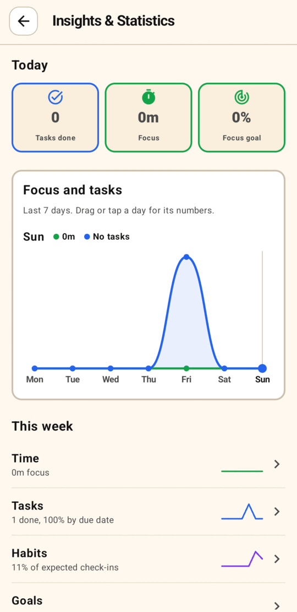

# Statistics

Statistics show how your focus time, tasks, habits and goals add up: today, over a week, month or year, and in patterns over the last few weeks.

  

## Open statistics

On Home, tap the chart button at the top right. The overview has three parts:

- **Today**: tasks done, focus time, and how much of your [daily focus target](focus.md#daily-focus-target) you've reached. It shows "-" on days without a target.
- **Focus and tasks**: a chart of the last 7 days, with focus time in green and completed tasks in blue. Tap or drag along it to see a day's numbers.
- **This week**: one row each for **Time**, **Tasks**, **Habits**, **Goals** and **Patterns**, with a short summary. Tap a row to open its page.

## Weeks, months and years

The **Time**, **Tasks** and **Habits** pages show one period at a time. Pick **Week**, **Month** or **Year** and use the arrows to go back in time.

Changes are always compared like for like. For a finished period, Timety compares it with the one before. For the current one, it compares the same number of days, for example "this week so far vs the same days last week". The page says which.

Once you use [tags](tags.md), pills at the top of these pages filter them by tag.

## Time

Your focus time per day, week or month, plus:

- **Avg session**: how long your sessions usually are.
- **Days goal met**: on how many days you reached your daily focus target.
- **Distractions** you logged during sessions.
- **By tag** and **By target**: where your time went. A session with two tags counts under both.

## Tasks

Tasks completed and created over the period, plus:

- **Done by due date**: how many of the completed tasks were finished in time.
- **By tag**: completed tasks per tag.
- **Typical time to finish**: how many days tasks usually take from creating them to checking them off.
- Average focus time by task size (**Effort**). This only counts tasks that were a focus target, and covers all time.

## Habits

The share of expected check-ins you made in the period, and under **Your habits**, one row per habit with its rate, current streak and best streak. See [Streaks](habits/index.md#streaks) for how streaks are counted.

## Goals

How many goals are **Active**, **Behind** and **Completed**. Each active goal has a bar with a mark showing where a steady pace would put you today, and when you'll finish at your current pace. Completed goals show how early or late you finished. Tag pills filter this page too. See [Goals](goals.md).

## Patterns

Patterns look at the last few weeks to show your habits over time, once there's enough data:

- **Peak focus time**, **Busiest day for tasks**, and how many minutes into a session you're **Typically distracted after**.
- **When you focus**: a grid of weekdays and times of day. A stronger color means more minutes.
- **By weekday**: your average focus time per weekday.
- **When you check in habits**: what time of day you usually do them.
- **Focus by mood**: average focus time on days you rated as good, okay or bad on the [Profile](getting-started.md#your-profile) tab.

Can I get my raw data?

Yes. **Settings › Data &amp; Backup › Export JSON Data** saves everything in a JSON file you can open in other tools. See [Backup and restore](backup-and-restore.md).

