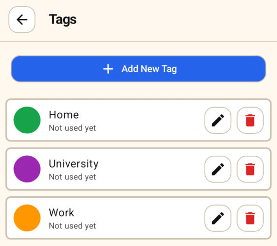

# Tags

Tags are your own labels, like "Work", "University" or "Home". One set of tags is shared by tasks, recurring tasks, habits, goals and focus sessions, so you can filter your lists by area and see how much time each one gets.

  

## Manage your tags

Go to **Settings › General › Tags**. Here you can:

- tap **Add New Tag**, enter a **Tag Name** and **Choose a Color**.
- tap the pencil on a tag to rename it or change its color.
- tap the bin to delete it.

Each tag shows how many items use it. Two tags can't have the same name, and "Work" and "work" count as the same name.

## Tag an item

In the editor of a task, recurring task, habit or goal, tap the **+** under **Tags** and pick one or more tags. You can also add a new tag right there.

Tags are an input you can hide; see [Customize forms](customize-forms.md).

## Filter by tag

Once you use tags, pills appear at the top of these lists:

- the **Tasks** tab and the **Recurring Tasks** page
- the **Habits** tab
- **Goals**
- the pages in [Statistics](stats.md)

Tap a pill to show only items with that tag. With several pills selected, an item needs all of them. For example, select "University" and "Meeting" to see only university meetings, not work ones.

## Tags and focus time

A focus session can count towards tags in two ways:

- Pick a tag as the session's target, on the **Tags** tab of **Select Focus Target**.
- Pick a task, habit or goal as the target. The session then gets that item's tags.

The session keeps these tags even if you change the item's tags later, so past time stays where it was. **[Statistics](stats.md) › Time** shows your focus time **By tag**. A session with two tags counts under both.

## Delete a tag

Deleting a tag removes it from every item that uses it. The items themselves stay. Focus sessions that had the tag keep their time, but it no longer counts towards any tag.

> [!CAUTION]
> Deleting a tag can't be undone. If you only want to stop using it, leave it in place: tags no item uses don't show up as filter pills.
