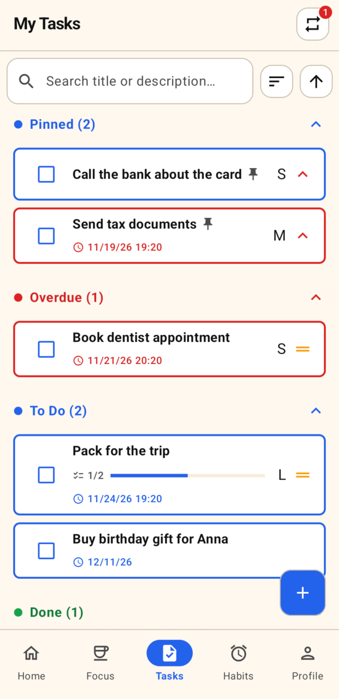
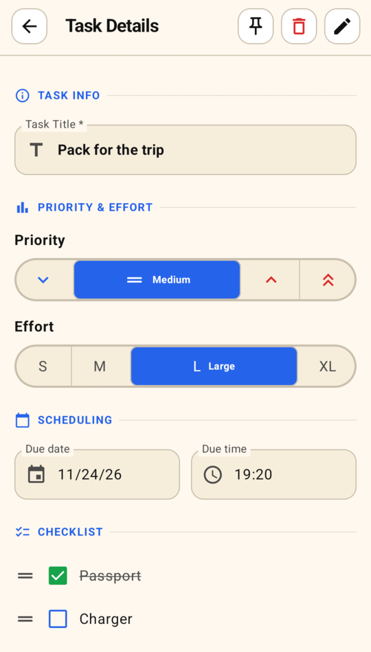

# Tasks

Tasks are things you need to get done once, like "Call the bank" or "Pack for the trip". Give them a due date, reminders, a checklist or a place, and check them off when they're done.

For things that come back on a schedule, like cleaning the flat every week, use [recurring tasks](recurring-tasks.md) instead.

  

## The Tasks list

The **Tasks** tab lists your tasks in sections:

- **Pinned**: tasks you pinned, whatever their due date.
- **Overdue**: tasks past their due date or time.
- **Due Today**: tasks due later today.
- **To Do**: tasks due later, and tasks without a due date.
- **Done**: tasks you've checked off.

Tap a section's title to collapse or expand it. Timety remembers which ones you've collapsed.

Above the list you can:

- **search** the title and description of every task.
- **sort** by **Due Date**, **Priority**, **Size** or **Alphabetical**. The arrow next to it switches between ascending and descending.
- **filter by tag** with the pills under the search bar. With several tags picked, a task needs all of them to show up.

Recurring tasks aren't in this list. Open them with the repeat button at the top right; its badge counts the rounds that are due today or overdue. See [Recurring tasks](recurring-tasks.md).

## Create a task

1. Tap the **+** button on the **Tasks** tab or on Home.
2. Enter a **Task Title**.
3. Fill in whatever else you need. All of it is optional and described below.
4. Tap the check mark at the top to save.

Some inputs are hidden on a new install: **Priority &amp; Effort**, **Location** and the **Task window**. Switch them on in **Settings › Forms**, see [Customize forms](../customize-forms.md).

## View and edit a task

Tapping a task opens **Task Details**, a read-only view that only shows what you filled in. This way you can't change a task by accident while reading it.

  

The buttons at the top let you **Pin**, **Delete** or **Edit** the task. In edit mode, tap the check mark to save your changes.

## Due date and time

Tap **Set Due Date** to pick a day. The **Due time** next to it says **All day** until you pick a time:

- **With a due time**, the task is overdue as soon as that time has passed.
- **Without one (all day)**, the task is due for the whole day and only becomes overdue once that day is over.

The **×** in each field clears it. Clearing the date also removes the reminders that count back from it, like **1 hour before**. **Custom** reminders stay.

## Reminders

Reminders are notifications before a task is due. They need a due date, so the **Add reminder** button appears once the task has one.

For a task with a due time, pick **On time**, **30 minutes before**, **1 hour before**, **1 day before**, **1 week before** or a **Custom** date and time. For an all-day task, reminders are whole days, like **On the day** or **1 day before**, and the sheet tells you at what time they arrive.

You can add several reminders to one task. When you change the due date, its reminders move with it.

> [!IMPORTANT]
> If reminders arrive late or not at all, open **Settings › Notifications** and allow **Background activity**. Some phones stop apps in the background to save battery. Also check that **Precise reminder timing** is allowed.

## Priority and effort

**Priority** goes from **Low** to **Very high** and is shown as an icon on the task. **Effort** marks how big a task is, from **Small** (S) to **Very large** (XL). Use them to sort the list. [Statistics](../stats.md) also shows how much focus time tasks of each size usually take.

## Checklist

A checklist splits a task into smaller steps.

1. In edit mode, type a step in **Add subtasks…** and tap the add button.
2. Long-press a step and drag it to change the order.
3. Tick steps off in **Task Details**, no need to switch to edit mode. In the lists, the task shows how many are done, for example **1/2**.

Ticking off every step doesn't complete the task. Check the task itself when you're done.

## Location

**Location** records where a task happens. Type a place yourself, or tap the search button to look one up. When you pick a search result, Timety saves its address and details, so **Place Details** still works offline.

The search needs internet. Without a connection you see "No internet connection – location search is unavailable", but you can still type a place by hand. Editing the text afterwards removes the saved place details.

## Complete a task

Tap the checkbox on a task, on Home, the Tasks tab, the [calendar](../calendar.md) or the [widget](../widgets.md). A message with **Undo** appears for a few seconds in case you tapped the wrong one.

If **Ask to log focus time** is on in **Settings › Focus**, which it is by default, Timety then offers to **Log Focus Time** for the task: enter how long you worked on it and it's saved as a focus session. Tap **Skip** to just complete the task.

To reopen a task, uncheck it in the **Done** section.

## Pin a task

Pin a task to keep it at the top of Home and the Tasks list, whatever its due date. Open the task and tap **Pin** at the top. Tap it again to unpin.

When you complete a pinned task, it unpins itself. **Undo** pins it again.

## Tags

Tags group tasks by area, like "Work" or "Home". Pick them under **Tags** in the editor. The same tags work for habits, goals and focus sessions; see [Tags](../tags.md).

Why doesn't my task show up on Home?

Home only lists tasks that are pinned, due today, overdue, or due within the **Upcoming Task Window** (**Settings › Tasks**, 7 days by default). Tasks without a due date, or due later than that, are only on the Tasks tab.

Where is the Priority or Location field?

It's switched off in **Settings › Forms**. New installs hide **Priority &amp; Effort**, **Location** and the **Task window** to keep the editor short. See [Customize forms](../customize-forms.md).

