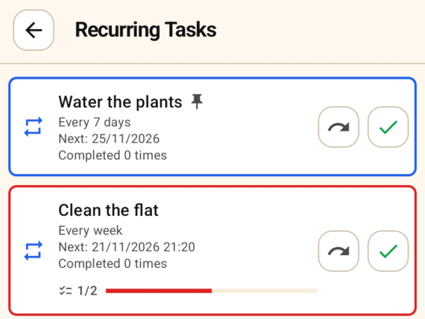
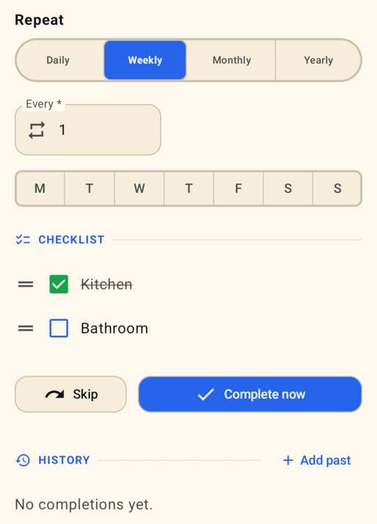

# Recurring tasks

A recurring task comes back on a schedule, like "Clean the flat" every Saturday or "Pay rent" on the first of the month. Each time it's due is called a round: complete or skip it, and the task moves on to its next due date.

  

## Find your recurring tasks

Recurring tasks have their own page. On the **Tasks** tab, tap the repeat button at the top right to open **Recurring Tasks**. Its badge counts the rounds that are due today or overdue: red if one is overdue, orange otherwise.

Each card shows the repeat rule, the **Next** due date, how often you've completed it and, if it has one, the checklist progress.

Rounds that are due soon also show up on Home under **Tasks Due** or **Upcoming Tasks**, in the [calendar](../calendar.md) and in the [tasks widget](../widgets.md). They don't appear in the list on the Tasks tab.

## Create a recurring task

1. Open **Recurring Tasks** and tap the **+** button.
2. Enter a **Task Title**.
3. Set **Next due**: the date of the first round. Add a **Due time** if it's due at a set time.
4. Under **Repeat**, pick **Daily**, **Weekly**, **Monthly** or **Yearly**, and how many of them lie between rounds in **Every**. For example, Weekly with Every 2 repeats every other week.
5. Save it.

The other inputs, like reminders, checklist, location and tags, work as they do for [tasks](index.md).

### Repeat rules

- **Weekly**: pick one or more days of the week. Every 1, Monday and Thursday, repeats twice a week. If **Next due** falls on a day you didn't pick, Timety tells you; that first round stays where it is and later rounds follow the picked days.
- **Monthly**: repeat **On day** 15 of the month, or on a weekday such as **On the third Fri** or the last Monday. A day that doesn't exist in a month, like the 31st, moves to that month's last day.
- **Yearly**: the same date every year. A task on 29 February falls on 28 February in other years.

## Complete a round

Tap the checkbox on Home, in the calendar or on the widget, or tap **Complete now** on the Recurring Tasks page. A message like "Completed! Next: 28/11/2026" shows the next due date, with **Undo** in case it was a mistake.

The next due date follows the schedule, not the day you completed it. If "Clean the flat" is due every Saturday and you do it on Monday, it's still due next Saturday.

If you complete a task long after it was due, missed rounds aren't piled up. The task jumps to its next round that isn't overdue yet.

### Complete a round early

Rounds that are still far away aren't shown on Home and have no buttons on their card. To complete one ahead of time anyway, open the task and tap **Complete now** at the bottom of its page.

  

## Skip a round

When you won't do a round, like cleaning the flat while you're on holiday, skip it instead of completing it. The round is logged as skipped in its history, not as completed.

- On the Recurring Tasks page, tap the skip button on the card.
- Or open the task and tap **Skip**. This works for any round, even one that's months away.

A message like "Skipped. Next: …" confirms it, with **Undo**.

### Auto-skip a round that's too close

Say "Water the plants" is due every Saturday at 10:00, and you only get to it on Friday evening. Without auto-skip, it's due again the next morning.

**Recurring Auto-Skip** in **Settings › Tasks** handles this. When you complete a task late and its next round is closer than the time you set, that round is skipped too. It's never more than a quarter of the time between two rounds, so a daily task done late isn't skipped for the next day. It's off by default; set it to 0 to switch it off again.

## The task window

The task window decides how early a round shows up on Home and in the widget. Until then, it's only on the Recurring Tasks page.

By default, a round shows up as many days before it's due as the **Upcoming Task Window** in **Settings › Tasks**, 7 days unless you changed it. To give one task its own window, switch on **Task window** in **Settings › Forms** first. Then, in the task's editor:

- **Default** uses the setting above.
- **Custom** shows the task a set number of **Hours**, **Days** or **Weeks** **Before due**. Hours are only offered for tasks with a due time.
- **On the due day** keeps the task out of sight until the day it's due.

For example, "Take out the bins" with **On the due day** stays off Home until bin day, while "Pay rent" with **Custom, 5 days** gives you time to plan.

## Checklist

A recurring task's checklist starts fresh each round: when you complete or skip a round, all steps are unticked again for the next one.

## Reminders

Reminders work like [task reminders](index.md#reminders) and apply to every round. They count back from each round's due date and time.

## History

The **History** section on the task's page lists every completed and skipped round, with totals.

- Forgot to check off a round? Tap **Add past** and pick when you did it.
- Logged something by mistake? Remove the entry from the list.

> [!WARNING]
> Deleting a recurring task also deletes its history. This can't be undone. If you only want to pause it, skip the rounds instead.

## Pin a recurring task

Open the task and tap **Pin** at the top. Pinned recurring tasks show in **Pinned** on Home and at the top of the Recurring Tasks page. Unlike one-off tasks, they stay pinned when you complete a round.

Why doesn't my recurring task show up on Home?

Its next round is still outside its task window. It shows up on Home once it gets closer, or you can find it on the Recurring Tasks page, where you can also complete it early.

I completed a round late. Why is the next one skipped?

**Recurring Auto-Skip** is on in **Settings › Tasks**, and the next round was closer than the time set there. Tap **Undo** right away, or set the setting to 0 if you don't want this.

Why didn't Timety ask me to log focus time?

The focus time prompt only appears for one-off tasks. To record time on a recurring task, pick it as the target on the Focus tab, or log a past session there. See [Focus](../focus.md).

