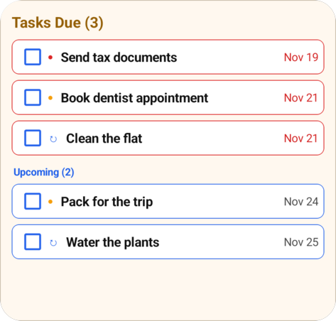
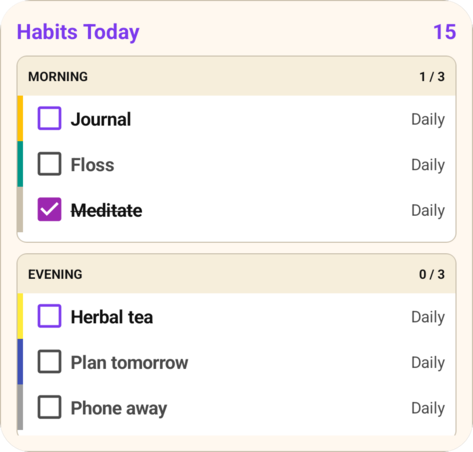

# Widgets

Timety has two home screen widgets: one for your tasks and one for today's habits. Check things off right from your home screen without opening the app.

## Add a widget

1. Touch and hold an empty spot on your home screen.
2. Tap **Widgets** and find **Timety**.
3. Drag the tasks or the habits widget to your home screen.
4. Resize it by touching and holding it, then dragging its edges.

The exact steps depend on your phone's launcher, but most work this way.

## Tasks widget

The tasks widget shows the same tasks as Home:

  

- **Tasks Due**: tasks and recurring tasks that are due today or overdue. When there are none, it says "No urgent tasks".
- **Upcoming**: tasks due within your **Upcoming Task Window** (**Settings › Tasks**).

Their borders use the same colors as in the app: red for overdue, orange for due today, blue for later.

- Tap a task's checkbox to complete it. For a recurring task, this completes the current round.
- Tap a task's name to open it in Timety.
- Tap the header to open the **Tasks** tab.

## Habits widget

The habits widget shows **Habits Today**: the habits due today, with the ones you've done marked.

  

- Tap a habit's circle to check it in, or to undo it.
- For a habit you do several times a day, each tap adds one, and the widget shows the count, for example 1/2.
- Habits in a [stack](habits/habit-stacks.md) are grouped together. If the stack has to be done in order, a locked habit can't be checked off on the widget either.
- Tap a habit's name to open it, or the header to open the **Habits** tab.

Monthly flexible habits aren't shown, since they're not due on any particular day.

## Colors and dark mode

Widgets use Timety's own colors. They follow your phone's light or dark setting, not the theme you chose in Timety, so they match the rest of your home screen.

My widget isn't up to date.

Widgets refresh when you change something in Timety and at midnight. If yours lags behind, allow **Background activity** in **Settings › Notifications**. Some phones stop apps in the background to save battery, which also delays widget updates.

